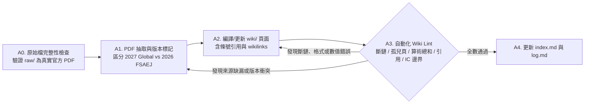
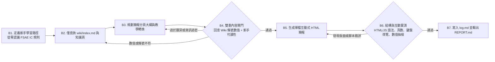

# Formula SAE (IC) LLM Wiki Schema & Workflow Specification

> 本文件定義此專案中 **LLM Wiki** 的結構規範、原始檔案攝取（Ingest）門檻、一致性檢查（Lint）機制，以及將 Wiki 編譯為教學型 HTML 簡報的 **Loop / Graph** 工作流。

---

## 1. 目錄架構（Repository Layout）

```text
LLM_Wiki/
├── SCHEMA.md                                # 本規範檔（Wiki 憲法與 Graph 定義）
├── raw/                                     # 不可變一手原始資料層（9 份官方 PDF，嚴禁 LLM 改寫）
│   ├── FSAE_Rules_2027_V1.pdf               # 2027 FSAE 官方規則書 V1（147 頁）
│   ├── 2026_FSAEJ_LocalRule_4th_20260616.pdf # 2026 日本學生方程式（FSAEJ）在地規則第 4 版（36 頁）
│   ├── 2026-_FSAE_IC_Design_Score_Sheet_20251008.pdf # 2026 FSAE IC 設計評分表（11 頁）
│   ├── 2027_Design_Briefing_Template.pdf    # 2027 設計簡報官方模板（26 頁）
│   ├── 2027_FSAE_Cost_Scenario.pdf          # 2027 成本情境題規範（5 頁）
│   ├── 2027_FSAE_Presentation_Concept.pdf   # 2027 商業簡報主題規範（8 頁）
│   ├── 2027_Presentation__Request_for_Proposal_-_Team_Response_Scoring_Rubric.pdf # Round 1 RFP 評分尺規
│   ├── 2027_Presentation_Virtual_&_Finals_Judging_Rubric.pdf # Round 2/3 評分尺規
│   └── Presentation_Concept_Discussion_and_Q&A_-_FAQ.final.pdf # 2027 簡報主題官方 FAQ（9 頁）
├── wiki/                                    # LLM 編譯維護的知識庫層（繁體中文）
│   ├── index.md                             # 全站目錄、學習路徑與來源對應表（Query 入口）
│   ├── log.md                               # 完整 Ingest / Lint / 錯誤攔截 / 簡報編譯日誌
│   ├── glossary.md                          # 新手必備術語、章節代碼與縮寫對照表
│   ├── rulebook-structure.md                # 2027 FSAE 規則書架構與行政/繳件規範（GR / AD / PS / V）
│   ├── chassis-and-passive-safety.md        # 車架與被動安全規範（F 節）
│   ├── driver-ergonomics-and-controls.md    # 車手人因、座艙防火、煞車與緊固件（V / T / VE 節）
│   ├── ic-powertrain-rules.md               # IC 內燃機動力、限流閥、燃油與排氣噪音（IC 節）
│   ├── technical-inspection-gauntlet.md     # IC 車檢四關卡全流程（IN 節）
│   ├── competition-scoring-1000pts.md       # 1,000 分制靜態與動態總覽（S / D 節 + IC 設計評分拆解）
│   ├── 2027-static-sdf-scenario.md          # 2027 靜態新制：Software-Defined Feature（簡報 + 成本共題）
│   └── fsaej-local-rules-diff.md            # 2026 日本站（FSAEJ）在地規則差異速查
├── presentation/
│   └── fsae-rulebook-101.html               # 單檔可離線瀏覽的教學型 HTML 簡報
└── REPORT.md                                # 作業報告（步驟三 Loop/Graph 設計 + 步驟四真實反思）
```

---

## 2. 核心原則與引用規範

### 2.1 Raw Layer 鐵律（Primary Source Integrity）
- `raw/` 目錄**只存放原始一手檔案（如官方 PDF）**，絕不存放由 LLM 改寫或拼湊的二手摘要。
- 原始 PDF 的文字抽取一律在臨時區（scratch）執行，確保 `raw/` 保持純淨與不可變。

### 2.2 Frontmatter 規格（所有 `wiki/*.md` 必填）
```yaml
---
id: page-slug
title: 頁面標題
rule_sections: ["IC", "IN"]
scope: FSAE-IC (2027 V1)
sources:
  - raw/FSAE_Rules_2027_V1.pdf
last_updated: 2026-11-21
verified: true
---
```

### 2.3 連結、條號與跨版本標註
- **內部連結**：使用 `[[page-slug]]` 或 `[[page-slug|顯示名稱]]`，禁止孤兒頁與斷鏈。
- **一手溯源**：凡提及規則條號與關鍵數值，必須標註實際 PDF 檔名與條號/頁碼，例如 `[src: raw/FSAE_Rules_2027_V1.pdf, IC.2.4.3, p.82]`。
- **版本與分站隔離**：本 Wiki 以 **2027 FSAE Global Rules（IC 組）** 為主體；凡涉及 **2026 FSAEJ 日本在地規則** 或 **EV 專屬條文**，一律以 `> [!NOTE]` 或獨立頁面明確標示，避免混用。

---

## 3. Loop / Graph 工作流設計（含 Shift-Left 改良版）

### Loop A：Wiki 建置與維護迴圈（v2：前移原始檔驗證與版本衝突閘門）


### Loop B：教學型 HTML 簡報生成迴圈

