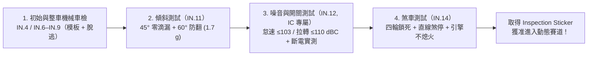

# IC 車檢四關卡全流程（IN 節）

依據 `IN.1.1`，任何賽車在通過所有適用車檢、取得 **Inspection Approval（IN.15.1）** 並貼上完整 **Inspection Sticker（IN.15.2）** 之前，**一律禁止進入任何動態項目** `[src: raw/FSAE_Rules_2027_V1.pdf, IN.1.1, p.115]`。且規則 `IN.2.2` 明訂：**規則書給定的尺寸皆為絕對值，不給任何量測誤差寬容值（No allowance）** `[src: raw/FSAE_Rules_2027_V1.pdf, IN.2.2, p.115]`。

> [!NOTE]
> **IC 與 EV 車檢路線隔離**：EV 組須經過 `IN.5` 電池箱檢、`IN.10` 高壓啟動檢與 `IN.13` **淋雨測試（Rain Test，噴水 120 秒 + 觀察 120 秒）**；**IC 組不考淋雨測試**，改考 `IN.12` **噪音與開關測試（Noise and Switch Test）** `[src: raw/FSAE_Rules_2027_V1.pdf, IN.10-IN.13, pp.120-122]`。

---

## 第一關：裝備、整車與座艙模板檢查（IN.4, IN.6–IN.9）
- **可視性要求（IN.2.3）**：所有待檢項目必須能直接目視檢查，不得要求裁判使用內視鏡或鏡子（須設計快拆護蓋或檢視孔） `[src: raw/FSAE_Rules_2027_V1.pdf, IN.2.3, p.115]`。
- **核心檢項**：車手防火裝備（`IN.4`）、[[chassis-and-passive-safety|車架與安全結構]]（`IN.6`）、[[chassis-and-passive-safety|95% 男性 Percy 模板]]（`IN.7`）、[[driver-ergonomics-and-controls|座艙開口與內部截面模板]]（`IN.8`）、車手安全帶與 5 秒脫逃檢查（`IN.9`），以及 [[ic-powertrain-rules|20.0 mm / 19.0 mm 限流閥]]。

## 第二關：傾斜測試（Tilt Test, IN.11）
驗證油液防漏與靜態防翻穩定度，通過後才可進入下一關（`IN.11.3`） `[src: raw/FSAE_Rules_2027_V1.pdf, IN.11, p.120]`：
- **測試條件（IN.11.1）**：全車油水加至最大容量、車隊**最高大的車手**坐於駕駛座；若 IC 引擎採機械驅動高壓燃油泵（DI），須先發動加壓下游管路。
- **45° 零滴漏（IN.11.2.1）**：平台傾斜至水平 **45°** 時，不得有任何型態的液體滲漏。
- **60° 防翻覆（IN.11.2.2）**：平台傾斜至水平 **60°**（等效橫向 **1.7 g**）時，車輛不得翻覆或翹輪。

## 第三關：噪音與開關測試（Noise and Switch Test, IN.12 — IC 專屬）
- **麥克風架設（IN.12.1.2）**：空檔靜止熱車，自由場麥克風與排氣出口同高、距離 **0.5 m**、水平夾角 **45°**（雙排氣管則逐一量測取最大值） `[src: raw/FSAE_Rules_2027_V1.pdf, IN.12.1-IN.12.2, p.120]`。
- **測試轉速（IN.12.4.1）**：對應平均活塞速度 **914.4 m/min（3,000 ft/min）** 換算並四捨五入至最接近的 500 rpm（工業引擎為 731.5 m/min） `[src: raw/FSAE_Rules_2027_V1.pdf, IN.12.4.1, p.121]`。
- **噪音上限（IN.12.5）**：
  - **怠速（Idle）**：**≤ 103 dBC**（Fast 加權）
  - **所有其他轉速（至最高測試轉速）**：**≤ 110 dBC**（Fast 加權） `[src: raw/FSAE_Rules_2027_V1.pdf, IN.12.5, p.121]`
- **開關實測（IN.12.7）**：同一站會實地測試外部主斷電開關（`IC.9.3`）、座艙主開關（`IC.9.4`）與/或 [[driver-ergonomics-and-controls|BOTS（T.3.3）]] 是否確實熄火 `[src: raw/FSAE_Rules_2027_V1.pdf, IN.12.7, p.121]`。

## 第四關：煞車測試（Brake Test, IN.14 — IC 專屬程序）
- **執行方式（IN.14.2.1）**：加速至指定速度（通常切入二檔）進入煞車區後，全力踩下煞車 `[src: raw/FSAE_Rules_2027_V1.pdf, IN.14.2.1, p.122]`。
- **兩大過關條件（IN.14.2.2）**：
  1. **四輪全部鎖死**並直線煞停。
  2. **全程引擎維持運轉不得熄火** `[src: raw/FSAE_Rules_2027_V1.pdf, IN.14.2.2, p.122]`。

> [!NOTE]
> **日本站（FSAEJ 2026）車檢補充**：車手須額外通過**旗號考試（Flag Test, `J2026-D-01`）** 取得手環才可下場；脫逃方向由現場裁判當場指定左或右側（`J2026-IN-02`）；且耐久賽後會抽測噪音並禁止修改引擎 Map（`J2026-IN-04`） `[src: raw/2026_FSAEJ_LocalRule_4th_20260616.pdf, pp.8, 19]`。

---
**相關頁面**：[[ic-powertrain-rules|IC 動力與噪音]] · [[competition-scoring-1000pts|動態計分項目]] · [[fsaej-local-rules-diff|日本站差異]]
